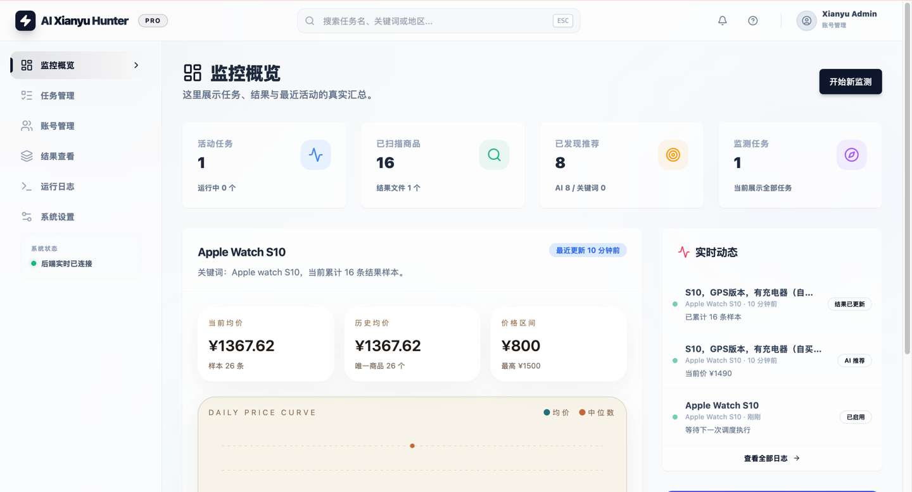
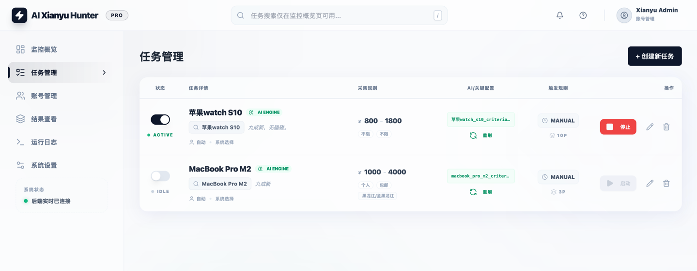
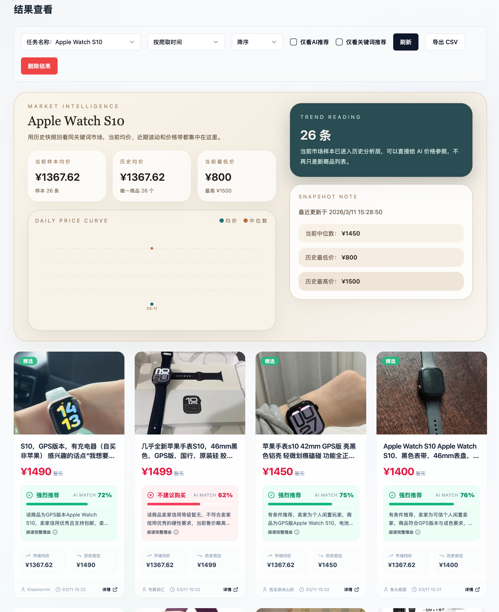
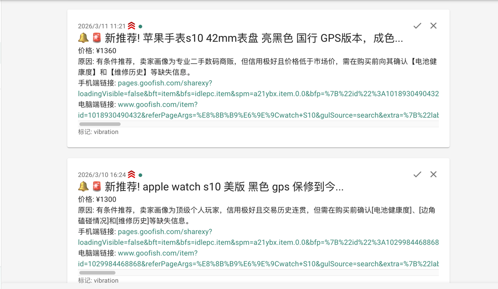
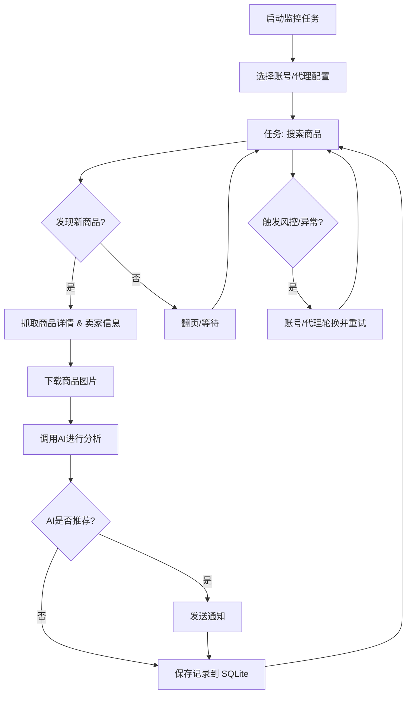

# 闲鱼智能监控系统

[中文] ｜ [English](README_EN.md)

基于 Playwright 和 AI 的闲鱼多任务实时监控，提供完整的 Web 管理界面。

[](https://github.com/<GITHUB_USER>/xianyu-smart-monitor/actions/workflows/ci.yml)
[](LICENSE)
[](https://www.python.org/)
[](https://nodejs.org/)
[](https://github.com/<GITHUB_USER>/xianyu-smart-monitor/releases)

> **来源说明**：本项目是 [Usagi-org/ai-goofish-monitor](https://github.com/Usagi-org/ai-goofish-monitor)（MIT，© 2025 dingyufei615）的**衍生版本**，不是从零开始的独立项目。
> 上游的重构与扩展清单见 [NOTICE](NOTICE) 与 [CHANGELOG](CHANGELOG.md)。上游的版权声明保留在 [LICENSE](LICENSE) 中。
>
> **仅供学习与技术研究**。请遵守闲鱼用户协议，不要提高抓取频率；详见 [免责声明](DISCLAIMER.md) 与 [安全策略](SECURITY.md)。

## 这个版本相比上游做了什么

除了上游已有的多任务并发、AI 多模态分析、多渠道通知、Docker 部署之外，本版本主要补的是**可判断性**与**可运维性**：

- **候选商品视图**：按「值得看 / 需核实 / 不匹配」分流，综合评分拆成匹配、价格、卖家、凭证四维
- **价格洞察**：同类均价、低/高价、样本数、划算度标签，价格历史落库
- **运行记录**：每轮抓取写入 `task_runs`，区分已完成 / 部分完成 / 无新增 / 异常退出 / 手动停止
- **账号健康**：从日志识别登录失效，首页提醒条 + 顶栏「需处理」直达重新扫码
- **噪声控制**：标题关键词预筛、结果黑名单规则、卖家画像缓存
- **日报与导出**：每日日报（可配小时）+ Excel 导出
- **运行保护**：全链路节奏控制、风控冷却、连续失败熔断、`is_running` 僵死自愈
- **本机免登录**：回环访问自动进工作台，`WEB_STRICT_AUTH=true` 时强制登录
- **插件生态**：DSH 插件（`plugins/dsh`）与 WorkBuddy 技能（`plugins/workbuddy`）

完整清单见 [CHANGELOG.md](CHANGELOG.md)。


## 核心特性

- **Web 可视化管理**: 任务管理、账号管理、AI 标准编辑、运行日志、结果浏览
- **AI 驱动**: 自然语言创建任务，多模态模型深度分析商品
- **多任务并发**: 独立配置关键词、价格、筛选条件和 AI Prompt
- **高级筛选**: 包邮、新发布时间范围、省/市/区三级区域筛选
- **即时通知**: 支持 ntfy.sh、企业微信、Bark、Telegram、Webhook等多渠道
- **定时调度**: 支持 Cron 配置周期性任务
- **账号与代理轮换**: 多账号管理、任务绑定账号、代理池轮换与失败重试
- **Docker 部署**: 一键容器化部署

## 工作台界面（V3）

当前 Web 界面按“候选商品 / 监控任务”两入口重新组织，不再使用永久左侧导航：

- **候选商品**：三列商品卡片，优先展示 AI 判断、价格依据和待核实项；人工状态（未查看 / 已收藏 / 已处理）与 AI 判断（建议关注 / 需核实 / 不匹配 / AI 分析失败）分开筛选。综合评分拆成匹配、价格、卖家、凭证四个维度，默认按综合评分排序。
- **账号失效提醒**：从任务日志识别登录失效，记录账号与失效时间，在首页显示提醒条，可直接去重新扫码或添加新账号。
- **监控任务**：任务表直接展示当前状态、最近一轮与下次运行；点击任务在表格下方展开运行记录、异常原因与已保存结果。
- **管理**：账号连接、通知、AI 判断、数据与安全收进右上角抽屉，账号或任务异常通过顶栏“需处理”直达。
- **运行记录**：每轮爬虫运行写入 `task_runs`，区分已完成、部分完成、无新增、异常退出与手动停止；历史日志也会被解析为运行记录。
- **结果状态**：`result_items.review_status` 保存人工处理状态，AI 判断在读取时根据分析结果与核实项派生，不会把分析失败误判为商品不合格。

相关接口集中在 `/api/workbench/*`：`summary`、`candidates`、`tasks`、`tasks/{id}/runs`、`issues`、`accounts`。

## 截图






## 插件与生态

监控服务跑起来之后，可以把它接进 agent，用自然语言查候选商品、看任务状态：

| 插件 | 面向 | 安装 |
|---|---|---|
| [`plugins/dsh`](plugins/dsh/) | DeepSeek Harness | `dsh plugin --profile demo add dsh-plugin-xianyu-monitor` |
| [`plugins/workbuddy/xianyu-monitor`](plugins/workbuddy/xianyu-monitor/) | WorkBuddy | 上传 `release/xianyu-monitor.zip` 到开放平台技能市场 |

两者都只是**本机 `127.0.0.1:8000` 的桥接层**，不含爬虫、不读登录态、不外传数据。
插件说明见 [plugins/README.md](plugins/README.md)，DSH 市场索引见 [market/](market/)。

```bash
node scripts/build-market-index.mjs          # 生成 DSH 市场索引
node scripts/validate-market-index.mjs market/index.json
node scripts/package-workbuddy-skill.mjs     # 打出 WorkBuddy 技能 zip
```

## 项目结构

```
src/                 后端（API → services → domain → infrastructure）
web-ui/              前端（Vue 3 + Vite + shadcn-vue + Tailwind）
spider_v2.py         爬虫 CLI 入口
tests/               测试（unit / integration / live）
plugins/dsh/         DSH 插件组合包（npm 包，注册 xianyu_* 工具）
plugins/workbuddy/   WorkBuddy 技能包（SKILL.md + scripts + references）
market/              DSH 插件市场索引与图标（可直接托管到 Pages）
scripts/             发布脚本（索引生成/校验、技能打包、版本检查、占位符替换）
data/ state/ logs/ images/ prompts/   运行时数据（不进仓库）
```

## 🐳 Docker 部署（推荐）

```bash
git clone https://github.com/<GITHUB_USER>/xianyu-smart-monitor.git
cd xianyu-smart-monitor
cp .env.example .env
vim .env # 填写相关配置项
docker compose up -d --build
docker compose logs -f app
docker compose down
```

本仓库**不提供预构建镜像**（代码已与上游差异较大，用上游镜像会得到旧版本）。
`docker-compose.yaml` 默认从本仓库构建；想用自己推的镜像时设 `APP_IMAGE`：

```bash
export APP_IMAGE=ghcr.io/<你的用户名>/xianyu-smart-monitor:latest
docker compose up -d
```

打 `v*` tag 时 [.github/workflows/docker-image.yml](.github/workflows/docker-image.yml) 会把镜像推到
`ghcr.io/<仓库所有者>/xianyu-smart-monitor`。

- 默认 Web UI 地址：`http://127.0.0.1:8000`
- Docker 镜像已内置 Chromium，无需宿主机额外安装浏览器。
- 如果你修改了 `.env` 中的 `SERVER_PORT`，请同步更新 `docker-compose.yaml` 里的端口映射。
- `docker-compose.yaml` 默认会把 SQLite 主库挂载到 `./data:/app/data`，数据库文件默认为 `data/app.sqlite3`
- 目前默认持久化这些目录：
    - `data/`  SQLite 主存储（任务、结果、价格历史）
    - `state/`  登录状态 cookie 文件
    - `prompts/`  任务提示词
    - `logs/`  运行日志
    - `images/`  商品图片与任务临时图片目录
    - `config.json`、`jsonl/`、`price_history/`  首次升级到 SQLite 时用于兼容导入的旧数据源

### 数据存储与迁移

- 当前在线主存储为 SQLite，默认路径 `data/app.sqlite3`
- 可通过环境变量 `APP_DATABASE_FILE` 自定义数据库路径；Docker 默认设置为 `/app/data/app.sqlite3`
- 应用启动时会自动建库建表，并尝试从旧的 `config.json`、`jsonl/`、`price_history/` 导入一次历史数据
- `state/`、`prompts/`、`logs/`、`images/` 仍然是文件系统目录，不在 SQLite 中
- 商品图片会临时落到 `images/task_images_<task_name>/`，任务结束后默认会清理
- 首次升级完成并确认 `data/app.sqlite3` 中数据正确后，可视部署方式决定是否继续保留旧的 `config.json`、`jsonl/`、`price_history/` 挂载

### 最少配置

| 变量 | 说明 | 必填 |
|------|------|------|
| `OPENAI_API_KEY` | AI 模型 API Key | 是 |
| `OPENAI_BASE_URL` | OpenAI 兼容接口地址 | 是 |
| `OPENAI_MODEL_NAME` | 支持图片输入的模型名称 | 是 |
| `WEB_USERNAME` / `WEB_PASSWORD` | Web UI 登录账号密码，默认 `admin/admin123` | 否 |
| `WEB_STRICT_AUTH` | `true` 时任何访问都要登录；`false`（默认）时本机回环访问自动进入工作台 | 否 |

其余配置见下方“配置说明”。


### 第一次使用

1. 打开默认 Web UI `http://127.0.0.1:8000`，本机访问会直接进入工作台（无需登录）。
2. 进入“闲鱼账号管理”，使用 [Chrome 扩展](https://chromewebstore.google.com/detail/xianyu-login-state-extrac/eidlpfjiodpigmfcahkmlenhppfklcoa) 导出并粘贴闲鱼登录态 JSON。
3. 登录态文件会保存到 `state/` 目录，例如 `state/acc_1.json`。
4. 回到“任务管理”，创建任务并绑定账号后即可运行。

### 创建第一个任务

- `AI判断`：填写“详细需求”，提交后会弹出独立进度弹窗，后台异步生成分析标准。
- `关键词判断`：填写关键词规则，任务会直接创建，不经过 AI 生成流程。
- `区域筛选`：已改为省 / 市 / 区三级选择器，数据基于闲鱼页面抓取快照内置。


## 用户使用说明

<details>
<summary>点击展开 Web UI 功能说明</summary>

### 任务管理

- 支持 AI 创建、关键词规则、价格范围、新发布范围、区域筛选、账号绑定、定时规则。
- AI 任务创建是后台 job 流程，提交后会打开单独的进度弹窗。
- 区域筛选会显著缩小结果集，默认留空。

### 账号管理

- 支持导入、更新、删除闲鱼账号登录态。
- 每个任务可指定账号，也可不绑定并交给系统自动选择。

### 结果查看与运行日志

- 结果页和导出功能现在从 SQLite 查询，不再直接扫描 `jsonl` 文件。
- 日志页按任务展示运行过程，便于排查登录态失效、风控和 AI 调用问题。

### 系统设置

- 可查看系统状态、编辑 Prompt、调整代理与轮换相关配置。

</details>


## 开发者开发

### 环境要求

- Python 3.10+
- Node.js + npm（本地验证 `Node v20.18.3` 可完成前端构建）
- Playwright CLI 与 Chromium，首次运行前建议执行 `python3 -m pip install playwright && python3 -m playwright install chromium`
- Chrome / Edge 浏览器（Linux 环境也可使用 Chromium；`start.sh` 会先检查浏览器是否存在）

```bash
git clone https://github.com/<GITHUB_USER>/xianyu-smart-monitor.git
cd xianyu-smart-monitor
cp .env.example .env
```

### 一键启动

```bash
chmod +x start.sh
./start.sh
```

`start.sh` 会先检查 Playwright CLI 和浏览器前置条件；在前置条件满足后自动安装项目依赖、构建前端、复制构建产物并启动后端。

### 手动启动

```bash
# 后端
python -m src.app
# 或
uvicorn src.app:app --host 0.0.0.0 --port 8000 --reload

# 前端
cd web-ui
npm install
npm run dev
```

- FastAPI 启动时会自动初始化 SQLite，并在首次启动时尝试导入旧的 `config.json/jsonl/price_history`
- `spider_v2.py` 默认从 SQLite 读取任务；只有显式传入 `--config <path>` 时才会走 JSON 配置兼容模式
- 默认数据库路径为 `data/app.sqlite3`
- Vite 开发服务器会将 `/api`、`/auth`、`/ws` 代理到 `http://127.0.0.1:8000`。
- `npm run build` 先生成 `web-ui/dist/`，`start.sh` 再复制到仓库根目录 `dist/`。
- FastAPI 负责提供根目录 `dist/index.html` 和 `dist/assets/`。
- `./start.sh` 默认输出访问地址 `http://localhost:8000` 和 API 文档 `http://localhost:8000/docs`。

### 测试与校验

```bash
# 后端测试
PYTEST_DISABLE_PLUGIN_AUTOLOAD=1 pytest

# 前端构建
cd web-ui && npm run build

# 插件与市场
node --check plugins/dsh/index.js
node scripts/build-market-index.mjs
node scripts/validate-market-index.mjs market/index.json
node scripts/check-plugin-versions.mjs
node scripts/package-workbuddy-skill.mjs
```

CI（[.github/workflows/ci.yml](.github/workflows/ci.yml)）会跑上述全部检查，外加敏感信息扫描与 Docker 构建。

> Windows 上如果 pytest 报 `collected 0 items` 或 `underlying buffer has been detached`，是控制台捕获的问题，
> 加 `-s` 关闭捕获即可：`pytest -q -s`。

### 任务创建 API

<details>
<summary>点击展开 API 行为说明</summary>

- `POST /api/tasks/generate`
  - `decision_mode=ai`：返回 `202` 和 `job`，需要继续轮询进度。
  - `decision_mode=keyword`：直接返回已创建任务。
- `GET /api/tasks/generate-jobs/{job_id}`：查询 AI 任务生成进度。
- `POST /auth/status`：校验 Web UI 登录凭据。

</details>

## 配置说明

<details>
<summary>点击展开常用配置项</summary>

### AI 与运行时

- `OPENAI_API_KEY` / `OPENAI_BASE_URL` / `OPENAI_MODEL_NAME`：AI 模型接入必填项。
- `PROXY_URL`：为 AI 请求单独指定 HTTP/SOCKS5 代理。
- `RUN_HEADLESS`：是否以无头模式运行爬虫；Docker 中应保持 `true`。
- `SERVER_PORT`：后端监听端口，默认 `8000`。
- `LOGIN_IS_EDGE`：本地环境可切换为 Edge 内核；Docker 镜像未内置 Edge，容器内会固定使用 Chromium。
- `PCURL_TO_MOBILE`：是否将 PC 商品链接转换为移动端链接。

### 通知

- `NTFY_TOPIC_URL`
- `GOTIFY_URL` / `GOTIFY_TOKEN`
- `BARK_URL`
- `WX_BOT_URL`
- `TELEGRAM_BOT_TOKEN` / `TELEGRAM_CHAT_ID` / `TELEGRAM_API_BASE_URL`
- `WEBHOOK_*`

### 代理轮换与失败保护

- `PROXY_ROTATION_ENABLED`
- `PROXY_ROTATION_MODE`
- `PROXY_POOL`
- `PROXY_ROTATION_RETRY_LIMIT`
- `PROXY_BLACKLIST_TTL`
- `TASK_FAILURE_THRESHOLD`
- `TASK_FAILURE_PAUSE_SECONDS`
- `TASK_FAILURE_GUARD_PATH`

### 抓取节奏与账号轮换（本版本新增）

- `SCRAPE_SPEED_FACTOR`：全局节奏倍率，1.0 为原始速度，**越大越慢**（建议 2.0~4.0）
- `SCRAPE_COOLDOWN_EVERY` / `SCRAPE_COOLDOWN_MIN_SECONDS` / `SCRAPE_COOLDOWN_MAX_SECONDS`：每处理 N 个商品做一次长休息
- `SCRAPE_MAX_RUNTIME_MINUTES`：单轮运行时长上限，到点主动收工，0 表示不限制
- `ACCOUNT_ROTATION_ENABLED` / `ACCOUNT_ROTATION_MODE` / `ACCOUNT_ROTATION_RETRY_LIMIT` / `ACCOUNT_BLACKLIST_TTL`：账号池轮换
- `ACCOUNT_STATE_DIR`：登录态文件目录，默认 `state`
- `RISK_CONTROL_PAUSE_SECONDS`：命中风控后冷却时长，默认 7200（2 小时）
- `ACCOUNT_RISKCONTROL_BLACKLIST_TTL` / `RISKCONTROL_RETRY_COOLDOWN_MIN_SECONDS` / `RISKCONTROL_RETRY_COOLDOWN_MAX_SECONDS`：风控账号拉黑与换号前休眠

### 每日日报（本版本新增）

- `DAILY_REPORT_ENABLED`：是否推送每日汇总
- `DAILY_REPORT_HOUR`：推送小时（0-23），默认 21

完整示例见 `.env.example`。

</details>

## Web 界面认证

<details>
<summary>点击展开认证说明</summary>

- 本机免登录（默认）：服务绑在回环地址、且请求来自本机回环时，中间件直接放行并在 `/auth/session` 返回 `{"auto": true}`，前端据此跳过登录页；不创建会话、不下发 cookie。
- 设置 `WEB_STRICT_AUTH=true` 可关闭免登录，所有访问都必须输入账号密码（演示、录屏、交付前自查时使用）。
- 登录通过 `POST /auth/status` 创建后端会话，浏览器以 HttpOnly、SameSite=Strict cookie 访问 API 和 WebSocket；本地登录标记不作为访问凭证。
- `GET /auth/session` 校验会话，`POST /auth/logout` 撤销会话。默认有效期为 12 小时，可通过 `WEB_SESSION_SECONDS` 调整；服务重启后需要重新登录。
- 未登录请求无法读取账号登录态、任务、结果、设置或 API 文档；跨站访问与连续失败登录会被限制。
- Windows 本地入口 `python -m src.app` 默认只监听 `127.0.0.1`。开放局域网或容器访问时需设置 `SERVER_HOST=0.0.0.0`，并先修改默认密码；非本机绑定使用默认密码时会拒绝启动。自行使用 uvicorn 命令时也须同步设置安全配置。
- 默认账号密码仍为 `admin/admin123`，建议在 `.env` 中修改；不要把含密码的 `.env` 或账号登录态分享给他人。

### 调度与运行结果

- 编辑、新增或删除商品任务时，仅重载该类任务，保留每日监控日报和僵死任务巡检。
- 浏览器意外关闭、登录失效或重试耗尽会作为异常结束传到命令行，并返回非零退出码；冷却跳过会单独记录，合法的零新增仍为正常完成。

</details>

## 🚀 工作流程

下图描述了单个监控任务从启动到完成的核心处理逻辑。主服务运行于 `src.app`，按用户操作或定时调度启动一个或多个任务进程。



## 常见问题

<details>
<summary>点击展开常见问题</summary>

### AI 任务创建为什么不是立即完成？

AI 模式会先生成分析标准，再创建任务。现在该流程已改为后台 job，提交后会显示独立进度弹窗，避免表单长时间卡住。

### 区域筛选为什么默认建议留空？

区域筛选会显著减少搜索结果，适合明确只看某个区域的场景。若你先验证整体市场，建议先不填。

### 本地页面打开后提示前端构建产物不存在？

说明根目录 `dist/` 缺失。可直接执行 `./start.sh`，或先在 `web-ui/` 里执行 `npm run build`，再确认构建产物已复制到仓库根目录。

### `./start.sh` 为什么提示缺少 Playwright 或浏览器？

这是脚本的前置检查。请先安装 Playwright CLI 与 Chromium，并确保系统中可用 Chrome / Edge（Linux 环境也可用 Chromium），然后重新执行 `./start.sh`。

</details>


## 致谢

<details>
<summary>点击展开致谢内容</summary>

本项目在开发过程中参考了以下优秀项目，特此感谢：

- [superboyyy/xianyu_spider](https://github.com/superboyyy/xianyu_spider)

以及感谢LinuxDo相关人员的脚本贡献

- [@jooooody](https://linux.do/u/jooooody/summary)

以及感谢 [LinuxDo](https://linux.do/) 社区。

以及感谢 ClaudeCode/Gemini/Codex 等模型工具，解放双手 体验Vibe Coding的快乐。

</details>


## 注意事项

<details>
<summary>点击展开注意事项详情</summary>

- 请遵守闲鱼的用户协议和robots.txt规则，不要进行过于频繁的请求，以免对服务器造成负担或导致账号被限制。
- 本项目仅供学习和技术研究使用，请勿用于非法用途。
- 本项目采用 [MIT 许可证](LICENSE) 发布，按"现状"提供，不提供任何形式的担保。上游版权声明与衍生说明见 [NOTICE](NOTICE)。
- 项目作者及贡献者不对因使用本软件而导致的任何直接、间接、附带或特殊的损害或损失承担责任。
- 如需了解更多详细信息，请查看 [免责声明](DISCLAIMER.md) 文件。
- 部署前请读一遍 [安全策略](SECURITY.md)：默认口令、登录态文件、公网暴露风险都写在那里。

</details>

## 参与贡献

- 提 bug 用 [Bug 报告模板](.github/ISSUE_TEMPLATE/bug_report.yml)，提需求用 [功能建议模板](.github/ISSUE_TEMPLATE/feature_request.yml)
- 开发约定、提交前自检、Commit 规范见 [CONTRIBUTING.md](CONTRIBUTING.md)
- 想改抓取频率或加代理池的 PR 不会被合并，原因写在 [SECURITY.md](SECURITY.md)
- 安全问题请走私密渠道，不要开公开 Issue

## Star History

[](https://www.star-history.com/#<GITHUB_USER>/xianyu-smart-monitor&Date)
