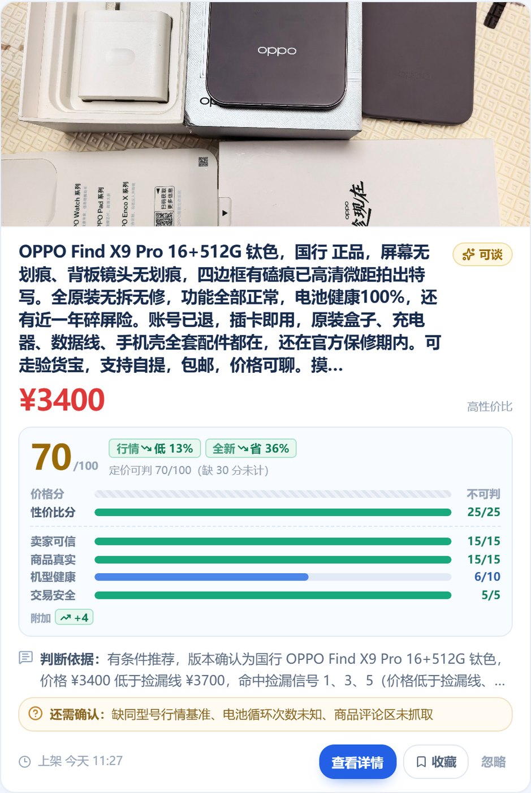
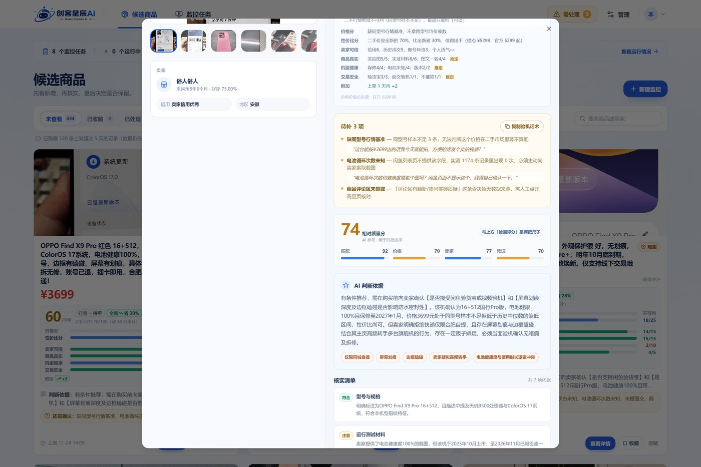
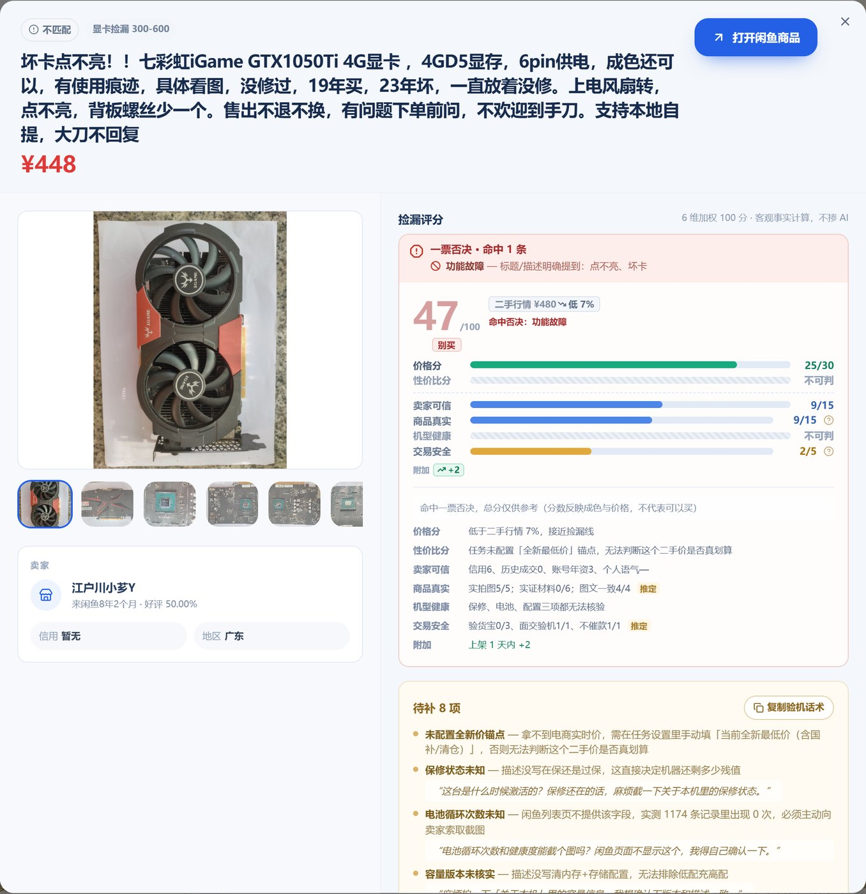

# 捡漏评分：给二手交易一套「能下决定」的绝对分

> 这是一份**展示说明**，对应分支 `showcase/offer-score`。
> 分支上只有本文档与截图，不动任何程序代码；代码本身已在 `main` 的 `64a1603`。

## 一句话

原来的评分回答「这台机器好不好」，新的捡漏评分回答**「这一单该不该下手」**——用可复算的客观事实凑齐 100 分，够 80 就冲，命中一票否决就写「别买」，拿不到数据的地方老实写「不可判」。

---

## 一、为什么要再做一个分

原来的 `resolve_overall` 是个**相对分**：把匹配 / 性能 / 价格 / 卖家 / 凭证加权，再掺 25% 的 AI `value_score`。它擅长排序，但没法回答「多少分以上可以买」——因为掺了 AI，又随品类动态增删维度，阈值是不可信的。

二手捡漏实际会栽两种跟头，而原模型只防住了第一种：

| 翻车方式 | 原模型 | 新的捡漏评分 |
|---|---|---|
| 买到骗子机 / 矿卡 / 坏卡 | ✅ 硬门槛已挡 | ✅ 保留，并扩充了词库 |
| 买了个「比全新只便宜一点」的所谓便宜 | ❌ 完全没防 | ✅ 新增「相对全新」价比 |

第二条是真实痛点：一台 ¥2000 的 X8s 在二手市场里确实偏低，但全新清仓只要 ¥2549——为了省 21% 去接一台没保修、可能用了两年的机器，并不划算。只看二手行情永远发现不了这件事。

---

## 二、六维 100 分，权重写在明面上

| 维度 | 权重 | 只看什么事实 |
|---|---|---|
| 价格分 | 30 | 相对**同型号**二手行情中位数（≥5 样本才判） |
| 性价比分 | 25 | 二手价 ÷ **当前全新最低价**（人工锚点） |
| 卖家可信 | 15 | 信用等级、历史成交、账号年资、个人/商家语气 |
| 商品真实 | 15 | 实拍图数量、实证材料、图文一致 |
| 机型健康 | 10 | 保修状态、电池健康/循环、容量版本核验 |
| 交易安全 | 5 | 验货宝、面交验机、是否催款、是否引导站外 |

前两项合起来 55 分，所以 UI 上用一条分隔线把它们和「人 / 货 / 机 / 交易」隔开——六个维度平铺会让人误以为权重相同。

**评级**：80 直接冲 / 60 可谈 / 40 观望 / 其余跳过；命中否决一律「别买」。

### 三条不肯让步的红线

1. **不猜。** 拿不到事实的维度标 `value=None`，界面写「不可判 / 缺口 xx 分」，绝不塞一个中位数蒙混，也绝不用重标定把「没比成价」洗成满分。
2. **分母永远是 100。** 缺项按 0 计、不剔除后重新标定。缺 25 分就是缺 25 分，任务最高只能到 75——这样「信息不全」这件事会被人看见，而不是被算法悄悄补平。
3. **不读 AI。** 这一整套只用标题/描述里能复算的事实，所以「80 分」这个阈值才站得住。

---

## 三、页面现在长什么样

### 列表：一眼扫过就知道先看哪台

每张卡片下半部分是评分面板：左侧大号总分，旁边两枚价格标签（`行情 ↓低 13%`、`全新 ↓省 36%`），再往下是六条维度进度条。右上角徽标只保留一个结论，且与下方评分**同源**。

### 单卡放大：进度条按「得分 / 满分」画

这张 70 分、评「可谈」：性价比 25/25 满格，机型健康 6/10 掉了一截，价格分是灰色虚线写「不可判」——同型号样本不足 3 条，宁可不给分。

两个刻意的设计：

- **进度条按得分/满分画，不是按 0–100。** 价格分满分 30，拿满就是满格；统一按 100 画的话所有维度都缩成一小截，看不出哪里掉了分。
- **不可判画成灰色虚线条，不画成空条。** 空条会被读成「这项得零分」，那是错误信息。

### 详情：说清「贵不贵」和「值不值」

顶部一句话给结论：`二手行情 ¥3699 — 持平`、`全新 ¥5299 ↓省 30%`。下面每个维度都带一句人话理由，掉分的写清为什么掉，缺数据的写清缺什么。底部还标注了锚点来源（`全新价锚点来源：官方 5299 起`），让人知道那个数是手填的还是没填。

### 两把尺子并排放，不合并

同一台机器：捡漏评分 **60**，相对质量分 **74**。界面直接写明「与上方（捡漏评分）是两把尺子」。

这不是冗余，而是必须拆开——**分数反映质量，评级反映该不该买**。混成一个数字，就再也拆不开「机器不错但价格不值」这种最常见的情形。

### 一票否决：分数高也不代表能买

这台 47 分，红色警示条写着「一票否决 · 命中 1 条 / 功能故障 — 标题/描述明确提到：点不亮、坏卡」，评级直接是「**别买**」，并把总分降为次要信息。

这个排序是有意的：**红条必须排在分数上面**，否则「47 分为什麼不能买」会被误读成系统算错了。

### 否决样本在列表里的样子

三张 RX580 分别是 **60 / 60 / 54** 分。这是本次改动最直接的可见收益——原先 `MISMATCH_CAP = 58` 会把所有被否决的记录压成同一个数字（实测 37 条显卡里 37 条全是 58），列表上根本看不出「哪张被否得可惜」。

---

## 四、改动落在哪里

### 后端（新增为主，几乎没动老逻辑）

| 文件 | 行数 | 作用 |
|---|---|---|
| `src/domain/scoring/offer_score.py` | 1134 | **核心**。六维评分、加减分、缺口清单、否决合成 |
| `src/domain/scoring/gpu_perf.py` | 262 | 显卡性能分：型号档位 + 显存 + 世代 → 0–100 |
| `src/services/publish_time_filter.py` | 115 | 上架时效本地兜底预筛 |
| `src/services/workbench_service.py` | +442 | 把绝对分算出来并挂到候选响应上 |
| `src/domain/scoring/engine.py` | +83 | 四维扩五维；不匹配分上限 58 → 68 且分档 |
| `src/services/ai_response_parser.py` | +48 | 修复模型把字段错挂进嵌套结构 |
| `src/infrastructure/persistence/sqlite_connection.py` | +28 | 新增全新价锚点两列（幂等迁移） |

### 前端

| 文件 | 作用 |
|---|---|
| `web-ui/src/components/candidates/OfferScorePanel.vue` | 394 行，评分面板本身（紧凑/详情两种模式） |
| `web-ui/src/components/candidates/CandidateCard.vue` | 徽标与评分同源，消除「一张卡两个结论」 |
| `web-ui/src/components/tasks/TaskForm.vue` | 任务设置里填全新价锚点 |

### 顺带修的两个真 bug

1. **字段被吞。** `deepseek-flash` 约 6 成响应会把 `shipping` / `seller_credit` 塞进 `criteria_analysis.seller_type` 里。JSON 完全合法，所以只看 `json.loads` 是否成功发现不了，字段却整段丢失。现在做一次幂等纠正搬回顶层。
2. **同一张卡两个结论。** 卡片徽标原在 `negotiate` / `watch` 时回退到 AI 判断，导致右上角写「需核实」、下面写「60 分可谈」。现在只要有绝对分就一律以它为准。

---

## 五、几个值得单独说的设计决定

**不匹配分上限从 58 放宽到 68，是不是在放水？**
不是。能不能买仍然由 `verdict = gates` 决定，分数只表示「这台本身有多好」，排序键另有 `AI_PRIORITY` 把 mismatch 压到后面。原先一律压成 58 的问题是**信息熵为零**——37 张卡全是 58，人只能一张张点开看。

**全新价为什么要人工填？**
项目只抓闲鱼，拿不到京东/淘宝实时价。让 AI 猜一个全新价等于凭空造数——猜低了会把所有机器判成「划算」。所以这一项由人在任务设置里填，留空时该维整维「不可判」，任务最高只能到 75 分。

**上架时长为什么本地算？**
LLM 做日期减法会把「11 分钟前发布」判成「超 3 天」。现在本地算好再以文本形式交给 AI。

**为什么还要一道本地时效预筛？**
闲鱼原生「新发布 3 天内」筛选失败时，`scraper` 的处理是「请求超时，继续执行」——也就是静默放行整页老商品，白开详情页、白下图片、白调 AI。本地再卡一道，行为才可预期。

---

## 六、现状

以本机真实库（434 条候选）实测：

- 全部 434 条都有绝对分
- 评级分布：可谈 2 / 观望 58 / 跳过 374
- 分数区间 7 – 70（当前没有 80+，因为多数任务还没配全新价锚点）
- 命中一票否决 126 条

相关单测 **171 项通过**（`test_offer_score` 601 行、`test_publish_time_filter` 217 行、`test_gpu_perf`、`test_color_priority`、`test_desktop_pollution_filter` 等）。

**已知待办**：全新价锚点目前只有个别任务配了，没配的任务性价比分恒为不可判，跨任务横向比分会偏低。补锚点是纯数据工作，不需要改代码。
